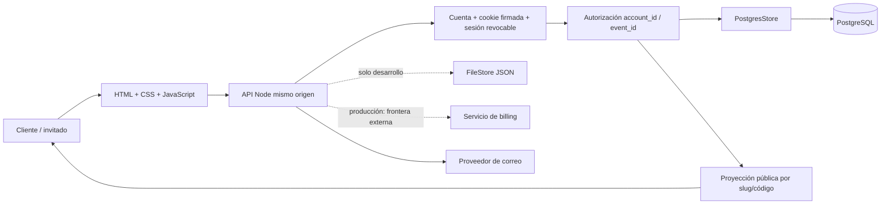
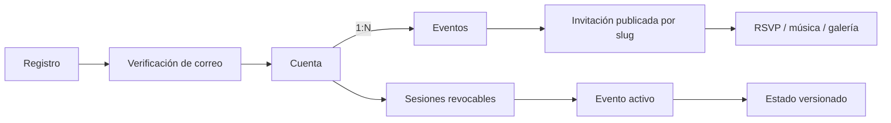

# Arquitectura técnica y alcance

Estado revisado: 11 de octubre de 2026. Nupcial es **un solo SaaS multi-cuenta**. Desarrollo conserva adaptadores de archivo, acceso demo y checkout ficticio; no son productos o versiones separados y están deshabilitados como acceso productivo.

## Tecnologías

| Capa | Tecnología | Uso |
|---|---|---|
| Interfaz | HTML, CSS y JavaScript sin framework | Inicio, catálogo, onboarding, panel e invitación pública. |
| Servidor | Node.js 20+, ES Modules, HTTP nativo | API, validación, sesiones, publicación y archivos estáticos. |
| Seguridad base | `node:crypto` | Scrypt, HMAC, tokens aleatorios y comparaciones seguras. |
| Persistencia productiva | PostgreSQL + `pg` | Cuentas, sesiones, eventos, permisos, revisiones y rate limits. |
| Persistencia local | Archivo JSON | Solo demo/desarrollo. |
| Entorno | Docker / Docker Compose | App y PostgreSQL local reproducible. |
| Pruebas | `node:test` + `node:assert` | Dominio, UI generada, API, aislamiento y diagramas. |

No se usan React, Next.js, Express, ORM ni microservicios. Aplicación y API comparten origen.

Esta tabla describe **Nupcial**, no el sitio usado como referencia. La interfaz pública observable de Festeja Bonito usa Next.js/React sobre Vercel, Tailwind CSS + CSS Modules y Lucide; su plano usa SVG, una capa compatible con `@dnd-kit` inferida y jsPDF 4.2.1. Evidencia, certeza y diferencias: [reference-festejabonito-client-seating.md](reference-festejabonito-client-seating.md).

## Arquitectura ejecutable

Componentes:

- `app.js`, `experience.js`, `marketing.js`, `core.js`: router hash, panel, experiencia pública y reglas compartidas.
- `server.mjs`: API, auth, autorización tenant-aware, validación y stores.
- `server/payments.mjs`: checkout mock local y frontera `external`; no cobra dinero.
- `db/migrations/001_core_schema.sql`: modelo relacional multi-tenant.
- `db/migrations/002_tenant_runtime.sql`: evento activo por sesión, estado versionado por evento y rate limits.
- `docs/system-map.js`: fuente de mapas SVG/Mermaid.

## Identidad, tenant y eventos

- Registro solicita solo correo. El token de un uso permite que el dueño del correo cree la contraseña al verificar; así un registro previo no fija una clave conocida por otra persona. Login y recuperación usan límites persistentes.
- Cada sesión de cuenta selecciona un evento accesible.
- Owner/editor pueden editar; viewer queda bloqueado en escritura. La interfaz para invitar colaboradores aún no existe.
- Cada lectura/escritura privada resuelve pertenencia de cuenta/evento. Pruebas A/B intentan seleccionar o modificar evento ajeno.
- Invitación pública solo resuelve eventos `published`; la proyección elimina teléfono, notas, mesas y otros campos privados.
- Escrituras usan revisión optimista para detectar pestañas concurrentes.

## Persistencia

PostgreSQL guarda identidad y autorización en tablas normalizadas. Estado funcional completo todavía vive como **un documento JSONB por evento** en `event_application_states`; `events` mantiene campos consultables sincronizados. Tablas normalizadas de invitados, mesas, RSVP, canciones y medios de `001` representan evolución prevista, pero módulos aún no escriben en ellas.

Esto ya evita antiguo singleton global para cuentas SaaS. `nupcial_demo_state` permanece únicamente como compatibilidad del login demo local.

## Medios y servicios externos

- Fotos, portada y audio siguen embebidos en JSONB como data URLs. Antes de carga real: object storage privado, URLs firmadas, cuotas, borrado y retención.
- Producción requiere proveedor HTTPS de email. Deben validarse contrato, dominio remitente, rebotes y entregabilidad.
- WhatsApp es enlace preparado; no hay envío automático.
- Billing real queda fuera. Producción comercial usa `PAYMENT_PROVIDER=external`; no existen tarjeta, SDK de pasarela o webhook en esta app. Una demo cloud puede habilitar explícitamente `PAYMENT_PROVIDER=mock` + `ALLOW_MOCK_PAYMENTS=true` sin rebajar `NODE_ENV`, cookies ni autenticación.

## Estado de preparación

Listo para demo local:

- Flujo visitante → cuenta → evento → panel → publicación → RSVP/música/galería.
- Múltiples cuentas y eventos aislados.
- Pago ficticio completo.
- Suite automatizada de dominio, UI generada, API, aislamiento, esquema y diagramas.

Antes de producción pública:

- Validar migraciones y flujos E2E contra PostgreSQL administrado.
- Integrar/probar proveedor de email real.
- Mover medios a object storage.
- Ensayar backup/restauración, observabilidad, alertas y retención.
- Añadir privacidad, términos y cierre/borrado de cuenta.
- Probar carga, accesibilidad y navegadores/móviles objetivo.

Rutas y recorrido: [manual-testing.md](manual-testing.md). Base de datos: [database.md](database.md). Mapa: [system-map.html](system-map.html).
