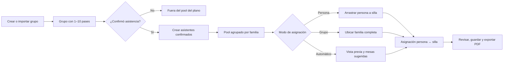
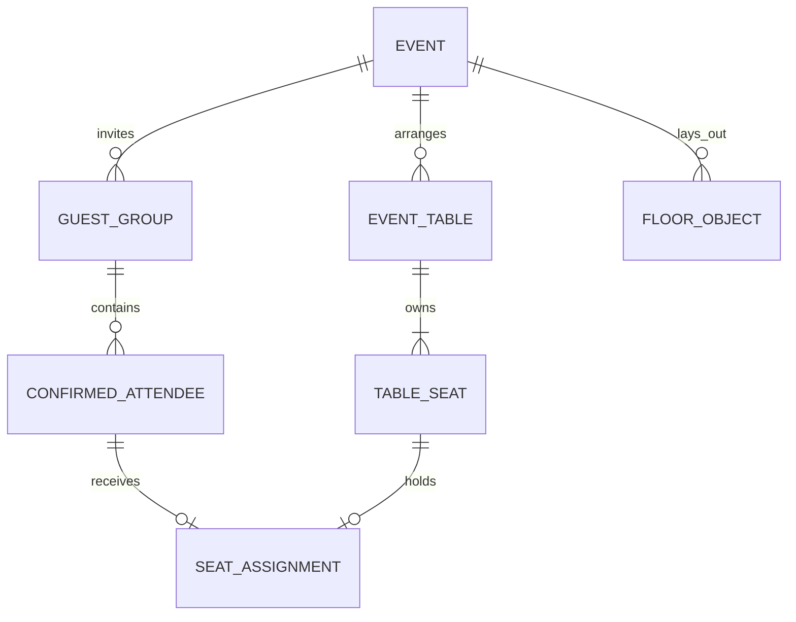

# Referencia funcional: invitados, confirmaciones y plano de mesas

**Revisión:** 11 de octubre de 2026, America/Lima.
**Origen:** inspección autorizada del panel cliente y de sus recursos cargados en el navegador.
**Privacidad:** este documento omite credenciales, cookies, tokens, códigos de invitación, nombres, teléfonos, mensajes, fotografías y cantidades pertenecientes a la cuenta revisada.

## Alcance y certeza

Este inventario conserva la estructura observable necesaria para reconstruir el recorrido cuando la cuenta de referencia deje de estar disponible. Describe controles, relaciones visibles y tecnología identificable desde el cliente. No afirma acceso al repositorio privado, reglas internas del servidor, esquema de base de datos ni comportamiento no ejecutado.

Convenciones:

- **Confirmado:** visible en DOM, recursos o salida producida por el navegador.
- **Inferido:** huella técnica fuerte, pero no código fuente privado.
- **Pendiente:** requiere una prueba aislada o documentación del proveedor.

## Tecnología observada

| Componente | Estado | Evidencia útil |
|---|---|---|
| Next.js + React | Confirmado | Recursos `/_next/`, React Server Components y encabezado `x-powered-by: Next.js`. |
| Vercel | Confirmado | Encabezados de entrega y despliegue de Vercel. |
| Tailwind CSS + CSS Modules | Confirmado | Clases utilitarias, estilos empaquetados y módulos CSS cargados por la aplicación. |
| Lucide | Confirmado | Iconos Lucide utilizados por controles del panel. |
| Editor SVG nativo | Confirmado | El plano se representa como SVG interactivo; mesas, sillas y objetos son nodos del documento, no una captura estática. |
| `@dnd-kit` | Inferido | La descripción accesible automática usa el identificador/patrón `DndDescribedBy` predeterminado de la librería. No se certificó versión. |
| jsPDF 4.2.1 | Confirmado | Generador cargado por exportación; documento A3 horizontal de dos páginas. |
| Supabase / Upstash | No confirmado | Dominios permitidos por CSP. La allowlist no demuestra que estos servicios almacenen datos del módulo. |

El dato tecnológico importante para clonar el plano es: SVG conserva geometría y atributos semánticos; la capa drag/drop gestiona puntero y teclado; jsPDF genera la salida sin depender del diálogo de impresión.

## Recorrido integrado

Regla central: los **pases** limitan cuántas personas pueden confirmar; los **asistentes confirmados** son las unidades que ocupan sillas. Un grupo organiza y comparte invitación, pero no sustituye a la persona en el plano.

## 1. Invitados

### Tablero y lista

La pantalla reúne indicadores de uso, grupos registrados y estado de pases. Controles observables:

- Crear invitado.
- Descargar lista.
- Importar invitados.
- Buscar por nombre o contacto.
- Filtrar por confirmación, envío, categoría y lado.
- Ordenar y cambiar densidad/columnas de la lista.
- Seleccionar filas y ejecutar acciones por grupo.
- Editar, preparar mensaje, abrir invitación, registrar respuesta manual, reabrir respuesta y eliminar.

### Alta manual

Dos tipos visibles:

1. **Grupo/Familia:** titular y varios pases para acompañantes.
2. **Individual + acompañantes:** titular individual con cupos asociados.

Campos funcionales observados:

- Tipo de invitación.
- Nombre del titular o grupo.
- Teléfono.
- Cupos/pases disponibles, de 1 a 10.
- Categoría opcional.
- Lado del evento.
- Notas internas privadas.

La nota es operativa del organizador y no debe proyectarse en la invitación pública.

### Importación CSV/XLS/XLSX

La importación acepta CSV y formatos Excel visibles `.xls`/`.xlsx`, con previsualización antes de confirmar. El contrato mostrado incluye:

| Campo | Uso |
|---|---|
| Nombre del grupo/titular | Identificador humano obligatorio. |
| Número de pases | Entero dentro del límite permitido. |
| Tipo de invitación | Grupo o individual. |
| Categoría | Segmentación opcional. |
| Lado | Novia, novio o ambos según configuración. |
| Teléfono | Contacto, con país/prefijo cuando corresponde. |

Para una reconstrucción segura, la previsualización debe mostrar fila original, resultado normalizado y error por fila; confirmar debe ser transaccional para evitar una lista parcialmente importada.

### Confirmación manual

Desde las acciones del grupo se abre un formulario alternativo al RSVP público:

- `Sí asistirá` o `No asistirá`.
- Un nombre por persona confirmada, limitado por los pases.
- Mensaje asociado a la respuesta.
- Guardar o cancelar.

Al confirmar, las personas nombradas alimentan el pool del plano. Al rechazar o reabrir, el sistema debe definir explícitamente qué ocurre con sillas ya ocupadas; esa política de backend no puede deducirse solo del formulario.

## 2. Confirmaciones

La sección funciona como lectura operativa de respuestas y puente hacia el plano:

- Métricas de asistentes, no asistentes y uso/respuesta.
- Listas separadas de asistentes y no asistentes.
- Búsqueda por persona o contacto.
- Filtro por tipo de asistencia.
- Orden y paginación.
- Detalle de respuesta y personas asociadas.
- Exportación diferenciada de confirmados y no asistentes.
- Respuesta manual y reapertura iniciadas desde Invitados.

No se verificó envío automático de notificaciones después de una corrección manual.

## 3. Plano de mesas

### Modelo visual

El módulo combina tablero, SVG y pool lateral:

- Estadísticas de mesas, capacidad, confirmados, personas ubicadas y pendientes de ubicar.
- Mesas redondas o rectangulares.
- Capacidad configurable entre 1 y 20 sillas.
- Color configurable para distinguir mesa o zona.
- Objetos de salón: entrada, pista, DJ, escenario, mesa de dulces, mesa de quesos y barra.
- Vista general/minimapa y panel de revisión.

Cada mesa y silla conserva identidad en el DOM mediante atributos como `data-mesa-id` y `data-silla-id`. Esto permite asignación precisa, accesibilidad, pruebas automatizadas y serialización estable.

### Pool de asistentes

El pool incluye **solo personas confirmadas**. La presentación mantiene la agrupación por familia/grupo y muestra los pases o integrantes relacionados. Pendientes y quienes no asistirán no deben aparecer como arrastrables.

Operaciones:

- Buscar asistentes.
- Ver personas ubicadas o sin ubicar.
- Seleccionar una persona.
- Arrastrar una persona hacia una silla libre.
- Asignar el grupo completo a una mesa con capacidad.
- Consultar mesas sugeridas.
- Liberar/reubicar una persona.

### Asignación individual

La unidad persistida es persona↔silla:

1. La persona confirmada se vuelve elemento draggable.
2. La silla libre es destino y expone mesa/silla por atributos de datos.
3. Soltar valida disponibilidad y asigna esa persona a esa silla.
4. La silla ocupada muestra estado y permite volver a mover al asistente.
5. Clic derecho sobre asiento ocupado libera la asignación observada.

Una implementación accesible debe ofrecer la misma acción sin arrastre: seleccionar persona, activar silla, confirmar cambio y anunciar resultado.

### Asignación de grupo completo

El grupo puede ubicarse como unidad de conveniencia, pero el resultado sigue siendo una asignación por persona/silla. Antes de aplicar:

- Validar que la mesa tenga suficientes sillas libres.
- Mantener a la familia completa cuando sea posible.
- No duplicar una persona ya sentada.
- Mostrar motivo si el grupo no cabe.

### Distribución automática

El flujo automático no aplica cambios a ciegas:

1. Calcula propuesta.
2. Presenta vista previa.
3. Mantiene familia completa como restricción visible.
4. Expone mesas sugeridas.
5. Permite aceptar o volver sin sustituir el plano actual.

No se certificó el algoritmo privado de optimización ni sus desempates. La reconstrucción debe tratar tamaño de familia, capacidad libre y asignaciones existentes como entradas explícitas y producir una propuesta determinista/auditable.

### Edición espacial

Herramientas observadas:

- Selección simple y múltiple.
- Mover mesas y objetos.
- Alinear elementos seleccionados.
- Espaciar/distribuir selección.
- Zoom y paneo.
- Minimapa/ver todo.
- Vista limpia.
- Revisión de pendientes y capacidad.
- Deshacer.
- Guardar.
- Restablecer.
- Exportar.

Guardar y Restablecer son acciones diferentes. Restablecer necesita confirmación y alcance claro; Deshacer debe operar sobre historial de edición, no sobre datos de otras celebraciones.

### Exportación

La salida observada usa **jsPDF 4.2.1**, formato **A3**, orientación **horizontal**, con **dos páginas**. Esto difiere de abrir `window.print()`: el archivo debe conservar encuadre y escala definidos por el módulo.

## Relaciones necesarias para reconstrucción

Campos mínimos recomendados, no atribuidos al backend privado:

- `guest_group`: id, event_id, display_name, pass_limit, status.
- `confirmed_attendee`: id estable, group_id, display_name, active.
- `event_table`: id, event_id, name, shape, capacity, color, x, y, rotation.
- `table_seat`: id estable, table_id, index, posición/ángulo.
- `seat_assignment`: event_id, attendee_id único, seat_id único, assigned_at, assigned_by.
- `floor_object`: id, event_id, type, label, geometry, z_index.

Capacidad, existencia de persona, pertenencia al mismo evento y unicidad de silla deben validarse dentro de una transacción.

## Diferencias frente a Nupcial local

| Capacidad | Referencia observada | Nupcial local actual |
|---|---|---|
| Render del plano | SVG interactivo. | DOM HTML/CSS con posiciones porcentuales. |
| Unidad de asignación | Persona confirmada ↔ silla. | Grupo confirmado ↔ mesa mediante `guest.table`. |
| Identidad de silla | Estable; `data-mesa-id` + `data-silla-id`. | Sillas visuales calculadas por índice; no se persiste silla. |
| Arrastre | Capa compatible con `@dnd-kit` inferida. | Drag & Drop HTML5 para grupo; Pointer Events para mover mesa/objeto. |
| Grupo completo | Coloca personas en sillas; conserva familia. | Asigna un único `table` al grupo. |
| Automático | Vista previa, familia completa y sugerencias. | Best-fit inmediato por tamaño de grupo; sin preview. |
| Edición | Multiselección, alineación y espaciado. | Multiselección y desplazamiento conjunto; sin alinear/espaciar. |
| Liberar | Persona/asiento, incluido clic derecho. | Desasigna grupo completo. |
| Exportar | jsPDF 4.2.1, A3 horizontal, dos páginas. | Diálogo de impresión del navegador. |
| Persistencia | Contrato privado no inspeccionado. | Documento JSONB versionado por evento; tablas normalizadas aún no activas. |

## Brechas que debe cerrar Nupcial para paridad

1. Dar ID estable a cada persona confirmada, incluso acompañantes.
2. Persistir sillas y asignaciones persona↔silla; no inferir ocupación por los primeros `N` asientos.
3. Migrar el esquema preparado grupo→mesa a persona→silla o añadir tablas compatibles.
4. Añadir asignación individual, liberar asiento y alternativa accesible al drag/drop.
5. Añadir preview automático, restricción de familia completa y mesas sugeridas.
6. Añadir color, alinear/espaciar, reset confirmado y PDF A3 propio.
7. Definir qué ocurre con asignaciones cuando un RSVP cambia, disminuye asistentes o se reabre.
8. Probar concurrencia: dos organizadores no deben ocupar la misma silla.

## Evidencia que no debe conservarse

- Cookies o cabeceras de autorización.
- Credenciales y enlaces de acceso.
- Códigos personalizados de invitados.
- HAR sin sanitizar.
- Nombres, teléfonos, mensajes, fotos o exportaciones reales.
- Capturas o videos sin redacción que se suban al repositorio.

La evidencia reutilizable es este contrato funcional, nombres genéricos de controles, relaciones, límites y huellas técnicas no secretas.
